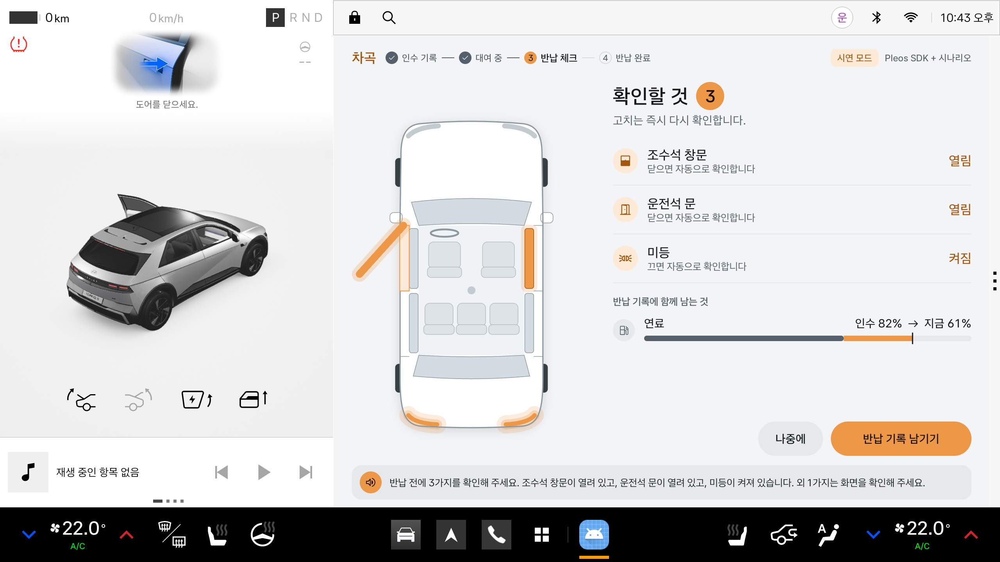

# 차곡 (Chagok)

렌터카 인수·반납 기록 앱입니다. **외관은 사진이, 기능은 차가 기록합니다.**

인수와 반납 때 차가 직접 읽은 상태(잔량, 주행거리, 경고등, 소모품, 타이어, 에어백, 문·창문·라이트)를 기록하고, 고객은 QR로 같은 기록을 자기 휴대폰에 받습니다. 반납 전에는 열린 문·창문과 켜진 라이트를 차 그림 위에 보여 주고, 고치는 즉시 다시 확인합니다.

| 반납 체크 | 반납 리포트 |
|---|---|
|  |  |

## 테스트 환경

| 항목 | 값 |
|---|---|
| 에뮬레이터 | Pleos Connect `Pleos_Connect_v2_1` (API 34, 2560×1440, 160dpi) |
| 차량 SDK | `ai.pleos.playground:Vehicle:2.3.2` |
| 앱 | minSdk 28, targetSdk 34, compileSdk 37 |
| 빌드 도구 | JDK 21, Gradle 9.8.2(래퍼 포함), AGP 9.2.1, Kotlin 2.3.21 |

실차에서는 아직 시험하지 않았습니다. 착석 값의 방향과 경고등 권한(`PRIVATE_CAR_SAFETY`) 승인은 실차 확인이 필요합니다.

## 실행 방법

Pleos 에뮬레이터를 켠 뒤 APK를 설치하고 실행합니다. 에뮬레이터의 앱은 사용자 10으로 돕니다.

```sh
adb install apk/팀명_차곡_release.apk
adb shell am start --user 10 -n app.chagok/.MainActivity
```

디버그 빌드가 이미 깔려 있으면 서명이 달라 설치가 거부됩니다. 먼저 `adb uninstall app.chagok`을 실행하세요.

소스에서 빌드하려면 `local.properties`에 `sdk.dir`을 적고 다음을 실행합니다.

```sh
./gradlew :app:assembleDebug     # app/build/outputs/apk/debug/app-debug.apk
./gradlew :core:test             # 규칙·기록 형식·음성 문구 테스트
```

## 시연 순서

1. **인수 기록:** '인수 기록 시작' → '확인하고 기록 시작'. 기록 값과 QR이 나옵니다. '확인'을 누르면 대여 중 화면으로 갑니다.
2. **대여 중 변화:** 화면 왼쪽 위 '차곡' 글자를 길게 누르면 직원 설정이 열립니다. '대여 중 변화 적용'을 누르면 312km 주행, 연료 21%p 감소, 앞 왼쪽 타이어 저압이 반영됩니다.
3. **반납 체크:** '반납 체크'를 누른 뒤 아래 Virtual Console로 문·창문·라이트를 바꿉니다. 차 그림과 목록이 바로 바뀌고 음성으로 알려 줍니다.
4. **반납 리포트:** '반납 기록 남기기'를 누르면 비교표와 QR이 나옵니다. 폰으로 QR을 찍으면 같은 무결성 값의 리포트가 열립니다.

### Virtual Console로 차 상태 바꾸기

```sh
adb forward tcp:8088 tcp:8088
# 값을 바꾸는 동안 세션을 유지한다(1초마다).
while true; do curl -s -X POST "http://127.0.0.1:8088/browser/session?client=demo" >/dev/null; sleep 1; done &

curl -X POST "http://127.0.0.1:8088/vehicle/body?door_fl=true"          # 운전석 문 열기 (false면 닫기)
curl -X POST "http://127.0.0.1:8088/vehicle/body?window_fr=100"         # 조수석 창문 열기 (0이면 닫기)
curl -X POST "http://127.0.0.1:8088/vehicle/lights?feature=headlamp_mode&value=Position"   # 미등 켜기 (Off면 끄기)
curl -X POST "http://127.0.0.1:8088/vehicle/telltales/simulator?type=TPMS&state=On&color=Red"  # 경고등 켜기
```

낮/밤 화면은 `adb shell cmd uimode night yes`(또는 `no`)로 바꿉니다.

### 시연 모드

에뮬레이터는 전기차 기준이고 일부 값을 바꿀 수 없어, 시연 모드에서는 휘발유 렌터카 시나리오 값을 함께 씁니다. 화면과 리포트에 '시연 모드'를 표시합니다.

- **Pleos SDK에서 읽는 값:** 문, 창문, 전조등·미등·실내등, 좌석, 경고등, 기어
- **시나리오 값:** 연료, 주유 후 주행거리, 주행거리, 배터리·충전, 엔진오일, 브레이크액, 워셔액, 타이어, 에어백

## 구조

| 경로 | 내용 |
|---|---|
| `core/` | 차량 없이 도는 Kotlin 모듈. 상태 모델, 비교 규칙, 기록 형식, 무결성 값, 음성 문구, 상태 전이 |
| `pleos/` | Pleos Vehicle SDK 어댑터 (`VehicleSource` 구현) |
| `app/` | 차량 앱. Compose 화면, 음성 안내, 로컬 저장, 시연용 차량 |
| `web/` | 고객 리포트 정적 페이지. https://rosieoh.github.io/chagok-report 에 배포 (`scripts/publish-web.sh`) |

## 기록과 개인정보

- 위치, 이름·연락처, 음성 원문, 운전 습관, 문 열림 이력은 기록하지 않습니다.
- 차량 제어 권한(`CONTROL_*`)과 위치 권한을 선언하지 않습니다.
- 리포트는 정규화한 JSON을 압축해 QR 링크의 `#` 뒤에 담습니다. `#` 뒤는 서버로 전송되지 않으므로 기록은 휴대폰 안에서만 풀립니다.
- 차 화면과 고객 페이지가 같은 내용의 SHA-256 앞 8자리(무결성 값)를 보여 줍니다.

## 제출 APK 만들기

```sh
./gradlew :app:contestApk -Pchagok.team=팀명     # apk/팀명_차곡_release.apk
```

서명 정보는 `local.properties`의 `chagok.release.signing`이 가리키는 파일에서 읽습니다. 이 설정이 없으면 디버그 키로 서명합니다.

## 사용한 오픈소스

- [Material Symbols](https://fonts.google.com/icons) (Apache License 2.0): 아이콘
- [ZXing](https://github.com/zxing/zxing) (Apache License 2.0): QR 코드 생성
- [Jetpack Compose](https://developer.android.com/compose), [kotlinx.coroutines, kotlinx.serialization](https://github.com/Kotlin) (Apache License 2.0)
