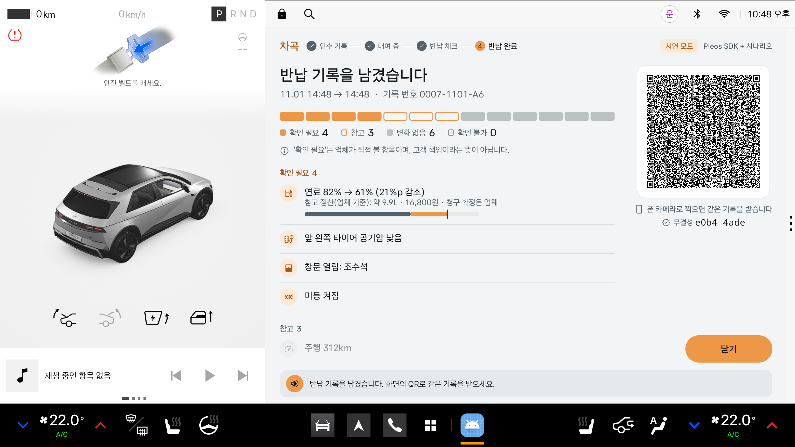

<picture>
  <source media="(prefers-color-scheme: dark)" srcset="brand/chagok-logo-dark.svg">
  
</picture>

# 차곡 (Chagok)

렌터카 인수·반납 기록 앱입니다. **외관은 사진이, 기능은 차가 기록합니다.**

인수와 반납 때 차가 직접 읽은 상태(잔량, 주행거리, 경고등, 소모품, 타이어, 에어백, 문·창문·트렁크·충전구·라이트)를 기록하고, 고객은 QR로 같은 기록을 자기 휴대폰에 받습니다. 반납 전에는 열린 곳과 켜진 라이트를 차 그림 위에 보여 주고, 고치는 즉시 다시 확인해 말로 알려 줍니다. 대여 중에는 경고등·소모품·에어백 변화를 이어서 기록합니다.

반납 지점까지 가면 얼마나 남는지 내비에게 물어 인수 때와 비교해 주므로, 충전하고 반납할지 미리 정할 수 있습니다. 도착하면 차가 반납 체크를 제안하고, 체크에서 확인할 것이 없으면 '네'라고 답해 반납 기록을 남길 수 있습니다.

| 반납 체크 | 반납 리포트 |
|---|---|
|  |  |

## 테스트 환경

| 항목 | 값 |
|---|---|
| 에뮬레이터 | Pleos Connect `Pleos_Connect_v2_1` (API 34, 2560×1440, 160dpi) |
| Pleos SDK | `Vehicle:2.3.2`, `TextToSpeech:3.3.1`, `SpeechToText:3.3.1`, `NaviHelper:3.0.5` (그룹 `ai.pleos.playground`) |
| 앱 | minSdk 28, targetSdk 34, compileSdk 37 |
| 빌드 도구 | JDK 21, Gradle 9.8.2(래퍼 포함), AGP 9.2.1, Kotlin 2.3.21 |
| 시연 콘솔 | Python 3 (표준 라이브러리만 사용) |

실차에서는 아직 시험하지 않았습니다. 착석 값의 방향, 경고등 권한(`PRIVATE_CAR_SAFETY`) 승인, 차대번호, 공기압 수치, 소모품·에어백 값, 내비의 실제 도착 이벤트, 마이크 인식은 실차 확인이 필요합니다.

## 실행 방법

Pleos 에뮬레이터를 켠 뒤 APK를 설치하고 실행합니다. 에뮬레이터의 앱은 사용자 10으로 돕니다.

```sh
adb install apk/팀명_차곡_release.apk
adb shell am start --user 10 -n app.chagok/.MainActivity
```

디버그 빌드가 이미 깔려 있으면 서명이 달라 설치가 거부됩니다. 먼저 `adb uninstall app.chagok`을 실행하세요.

소스에서 빌드하려면 `local.properties`에 `sdk.dir`을 적고 다음을 실행합니다.

```sh
./gradlew :app:assembleDebug     # app/build/outputs/apk/debug/app-debug.apk
./gradlew :core:test             # 규칙·기록 형식·음성 문구 테스트
```

## 시연 순서

옆 창에서 시연 콘솔을 켜고, 차 화면은 터치로 진행합니다.

```sh
python scripts/demo-console.py        # 번호를 눌러 장면을 실행한다
```

**이 값은 Virtual Console로 에뮬레이터에 주입합니다.** 앱은 실차와 같은 방법(Pleos SDK)으로 읽지만 값 자체는 실차 값이 아닙니다. 콘솔은 장면마다 무엇을 주입하는지 그대로 찍고, 앱은 화면 위 띠, 직원 화면, 기록(`"source":"emulator"`), 고객 웹에 에뮬레이터 값이라고 밝힙니다.

| 순서 | 어디서 | 무엇을 |
|---|---|---|
| 1 | 콘솔 `0` | 초기 설정: 포트 연결, 시간대 Asia/Seoul(콜드 부트하면 돌아가서 콘솔을 켤 때마다 맞춥니다), 알림 권한 |
| 2 | 콘솔 `1` | 시작 상태: 모두 닫힘, 배터리 82%, 주행거리 23,410km, P단 |
| 3 | 차 화면 | '인수 기록 시작' → '확인하고 기록 시작' → QR → '폰으로 받았습니다' |
| 4 | 콘솔 `2` | 주행: 기어 D, 주행거리 +312km, 배터리 61%, 기어 P |
| 5 | 차 화면 | '반납하러 가기'. 내비가 계산한 '도착하면 약 57%, 인수 때 82%'(교통 상황에 따라 1~2%p 달라집니다)와 참고 정산, '근처 충전소 보기', '경로 안내 시작'이 나옵니다 |
| 6 | 콘솔 `e`, `3` | 반납 지점까지 주행(+26km, 배터리 56%)과 놓친 것: 조수석 창문, 트렁크, 실내등, 뒷좌석 감지 |
| 7 | 직원 화면 | '도착 재현'. 5초 뒤 '반납 지점에 도착했습니다'가 말과 화면으로 나옵니다. 그 사이 내비 화면으로 가면 알림으로 나옵니다 |
| 8 | 차 화면 | '반납 체크 시작'. 차 그림과 목록에 네 가지가 나오고 음성으로 알려 줍니다 |
| 9 | 콘솔 `4`를 네 번 | 하나씩 닫습니다. 고칠 때마다 그 줄이 체크로 바뀌고 숫자가 줄며 '조수석 창문이 닫혔습니다' 같은 안내가 나옵니다 |
| 10 | 차 화면 | '모두 확인됐습니다. 반납 기록을 남길까요?' 뒤에 '듣는 중'이 뜹니다. '네'라고 답하거나 '반납 기록 남기기'를 누릅니다. 비교표, 참고 정산, QR이 나옵니다. 폰으로 찍으면 같은 무결성 값의 리포트가 열립니다 |

그 밖의 장면: `5` 충전(지금 값에서 인수 때 82%까지), `6` TPMS 경고등·타이어 저압, `7` 경고등 끄기, `8` 기어 D(반납 체크 중이면 체크가 취소되고, 플랫폼이 앱을 '주행 중에는 사용할 수 없습니다'로 가립니다. 트렁크가 열려 있으면 시스템 경고창이 먼저 뜹니다), `9` 기어 P, `a` 앱 열기, `b` `c` `d` Gleo 입구, `s` 지금 값 보기. `python scripts/demo-console.py 1 2`처럼 번호를 넘기면 차례로 실행하고 끝냅니다.

- **직원 화면:** 화면 왼쪽 위 '차곡'을 길게 누릅니다. 무효 처리와 직원 반납 기록은 직원 PIN을 받습니다. 시연값은 `2580`입니다(`AppSettings.staffPin`).
- **앱을 켠 뒤 바로 시작하지 마세요.** 부팅 뒤 처음에는 Speech Service가 음성 모델을 올리느라 첫 안내가 6~25초 늦습니다. 앱을 켜 두고 30초쯤 기다렸다가 시작합니다.
- **경로 안내:** '경로 안내 시작'을 누르면 10초쯤 뒤 내비가 화면에 뜨고 경로와 도착 예상 배터리를 보여 줍니다. 그 사이 내비를 누르지 마세요. 차가 바쁠 때 내비가 멈춰(ANR) 다시 뜬 적이 있습니다.

- **시간:** 시각은 속이지 않습니다. 인수와 반납이 실제로 몇 분 차이라 312km를 달린 것처럼 보이는 간격은 PT에서 '며칠 뒤로 가정합니다'라고 말합니다(콘솔 `2`가 대본을 찍습니다). 상태 표시줄은 콘솔 `0`이 맞춘 서울 시간으로 리포트 시각과 같습니다.
- **주행거리:** Virtual Console은 주행거리를 줄이지 않습니다. 23,410km로 다시 맞추려면 에뮬레이터를 콜드 부트합니다. 리포트는 차이만 보므로 이야기는 그대로입니다.
- 낮/밤 화면은 `adb shell cmd uimode night yes`(또는 `no`)로 바꿉니다.

### 값의 출처

`gradle.properties`의 `chagok.demoMode`로 정합니다. 빌드할 때 `-Pchagok.demoMode=scenario`로 바꿀 수 있습니다.

| 모드 | 값 | 화면 표시 |
|---|---|---|
| `live`(기본) | Pleos SDK 값만 씁니다 | 실차는 표시 없음. 에뮬레이터는 '에뮬레이터', 'Pleos SDK · 에뮬레이터(Virtual Console 주입)' |
| `scenario` | 문·창문·트렁크·라이트·좌석·경고등은 SDK, 나머지는 휘발유 렌터카 대본. 직원 화면에 '대여 중 변화 적용' 버튼 | '시연 모드', 'Pleos SDK + 시나리오' |

Pleos 차량 서비스가 없는 환경(일반 에뮬레이터·개발 PC)은 가짜 차량으로 돌고 '시연 모드', '가짜 차량(Pleos 서비스 없음)'으로 드러냅니다.

Pleos 에뮬레이터(전기차)의 live 리포트 칸은 다음과 같습니다(2026-11-02 확인).

| 구분 | 칸 |
|---|---|
| SDK에서 읽음 | 배터리, 주행거리, 경고등, 문, 트렁크, 충전구, 창문, 전조등, 미등, 실내등 |
| 경고등으로 판단 | 타이어: 공기압 수치 속성이 차량 서비스에 없어 TPMS 경고등을 근거로 '공기압 경고 없음'·'공기압 경고등 켜짐'이라고 적습니다 |
| 이 차에 없음(칸을 만들지 않음) | 연료, 주유 후 주행거리, 엔진오일, 브레이크액, 워셔액, 에어백 |
| 읽다 실패하면 | '확인 불가'로 남깁니다 |

차대번호는 에뮬레이터가 `"invalid"`를 주므로 업체 등록 번호 V-0007로 대신하고 그 사실을 기록(`"noVin":true`)과 직원 화면, 고객 웹에 남깁니다. 차대번호를 읽으면 기록에 그대로 쓰고 화면에는 끝 6자리만 보여 줍니다.

참고 정산의 단가(전기 350원/kWh, 휘발유 1,700원/L)와 탱크 용량은 시연용 업체 기준(가정)이고, 배터리 용량은 차가 주는 값(에뮬레이터 77.4kWh)을 먼저 씁니다. 청구 확정은 업체 몫입니다.

### 음성 안내

Pleos TTS(`ON_DEVICE`)로 말하고, 쓸 수 없으면 Android TTS로 넘어갑니다. 둘 다 안 되면 자막만 보여 줍니다. 직원 화면에 지금 엔진('음성 Pleos TTS', '음성 자막만')을 표시합니다. 안내 소리는 내비게이션 안내 용도(`USAGE_ASSISTANCE_NAVIGATION_GUIDANCE`)로 나가고, 말하는 동안 앱이 오디오 포커스를 잡습니다(Speech Service는 잡지 않습니다).

2026-11-02 에뮬레이터에서 확인한 것:

- 재생: 말하는 동안 `bus1_navigation_out` 출력이 대기 상태가 아니고 트랙이 활성입니다. Speech Service 로그의 `TotalWrittenBytes`가 문장 길이와 맞습니다(59자에 325,632바이트, 22.05kHz 16비트 모노로 7.4초). `onDone`은 재생이 끝난 뒤에 옵니다.
- 끊고 말하기: 창문을 닫으면 앞 안내가 페이드아웃되고 0.1초 안에 새 안내를 요청합니다. 합성에 0.6초쯤 걸려 1초 안에 들립니다.
- 넘어가기: `appops set app.chagok PLAY_AUDIO deny`로 막으면 `PERMISSION_DENIED` → Android TTS(status=-1) → '자막만'으로 넘어갑니다.
- Android TTS는 이 에뮬레이터에서 쓸 수 없습니다. 기본 엔진이 없고, `ai.pleos.playground.caas`를 직접 지정해도 status=-1입니다.
- 귀로 듣는 확인은 사람이 해야 합니다. 위 값은 소리가 출력 장치까지 간다는 증거이지 들린다는 증거는 아닙니다.

### 반납 지점 길안내

대여 중 화면의 '반납하러 가기'는 내비에 연결됐을 때만 보입니다. `requestTrip`의 도착 예상 배터리를 인수 때와 비교하고, 허용 오차(2%p)보다 낮으면 리포트와 같은 계산의 참고 정산과 '근처 충전소 보기'를 함께 보여 줍니다. 값을 받지 못하면 바로 경로 안내(`requestRoute`)만 합니다. 반납 지점은 `AppSettings.returnPoint`의 가상 지점 '반납 지점(시연)'이고, 서울시청 앞 좌표를 빌려 씁니다.

이 앱이 요청한 길안내에서 `onDestinationArrived`가 오면 대여 중일 때만 T-11을 말하고(P단이 된 뒤) '반납 체크 시작'을 보여 주며, 앱이 뒤에 있으면 알림을 띄웁니다. 고객이 직접 설정한 목적지의 도착은 무시합니다. 도착 사실은 메모리에만 두고 저장하지 않습니다.

- 에뮬레이터에서 확인: `requestTrip`→`onTripInfo`(내비 화면의 값과 같은 56~57%), `requestRoute`→내비 경로 안내(28분·26km), 근처 충전소 화면, 알림과 탭.
- 확인하지 못함: **실제 `onDestinationArrived` 이벤트.** 내비 설정에 모의 주행이 없고, 내비는 에뮬레이터 GPS의 NMEA 체크섬(`*47` 고정)을 거부해 차가 움직이지 않습니다. 그래서 직원 화면에 '도착 재현'을 두었고, 진짜 이벤트와 같은 길로 갑니다. 실차(`ValueSource.PLEOS`)에는 이 버튼이 없습니다.
- 내비는 SOC가 아니라 배터리 에너지(`EV_BATTERY_LEVEL`)로 계산합니다. 콘솔은 둘을 함께 맞춥니다. Virtual Console에서 SOC만 바꾸면 '도착하면 약 95%'처럼 어긋납니다.

### Gleo

`app/src/main/assets/schema.json`에 함수 3개를 정의했습니다. 어느 앱이든 같은 인텐트를 보낼 수 있으므로 되돌릴 수 있는 일만 받습니다. **기록 확정·무효·닫기는 입구가 없고,** 파라미터는 받지 않습니다(모양만 검사하고 값은 쓰지 않습니다).

| 함수 | 부르는 방법 | 하는 일 | 받지 않을 때의 답 |
|---|---|---|---|
| `RENTAL_START_RETURN_CHECK` | activity | 앱을 열고 반납 체크를 시작. 요약은 앱이 말합니다(`mode: silent`) | 대여 없음, P단 아님, 기록을 믿을 수 없음, 반납 완료, 무효 |
| `RENTAL_WHAT_TO_CHECK` | service | 화면 없이 지금 고칠 것과 배터리 차이를 6초 안에 답합니다. P단이면 앱이 직접 말하고(`silent`), 주행 중이거나 앱이 말할 수 없으면 Gleo가 말하게 합니다(`voice`) | 대여 없음, 기록을 믿을 수 없음, 반납 완료, 무효, 시간 초과, 앞 요청 처리 중 |
| `RENTAL_SHOW_RECORD` | activity | 대여 중이면 인수 기록과 QR을 엽니다 | 대여 없음, 반납 체크 중, P단 아님, 기록을 믿을 수 없음 |

**확인 범위: adb로 입구만 확인했고, 음성 호출은 Pleos의 스키마 승인을 기다립니다.** 설치 때 Gleo가 스키마를 읽는 것(`[Schema] Loaded schema.json from app.chagok`, `functionCount=3`)과 응답 브로드캐스트가 Gleo에 닿는 것(`processReceiver(): APP_ACTION_RESPONSE`)까지 확인했습니다. 시험은 콘솔 `b` `c` `d`나 다음과 같이 합니다.

```sh
adb shell am start --user 10 -a RENTAL_START_RETURN_CHECK -p app.chagok --es ACTION_PARAM '{}'
adb shell am broadcast --user 10 -a RENTAL_WHAT_TO_CHECK -p app.chagok --es ACTION_PARAM '{}'
adb shell am start --user 10 -a RENTAL_SHOW_RECORD -p app.chagok --es ACTION_PARAM '{}'
```

앱을 강제 종료(`am force-stop`)하면 Android 규칙상 `RENTAL_WHAT_TO_CHECK` 브로드캐스트는 앱을 한 번 열 때까지 오지 않습니다.

### 말로 답하기

'반납 기록을 남길까요?'에 답할 수 있습니다. 질문이 화면에 있고(고칠 것이 없고 P단이고 앱이 보일 때), 안내가 끝난 뒤에만, 마이크가 켜진 때부터 5초 듣습니다. 듣는 동안 '듣는 중'을 보여 주고 버튼은 그대로 있습니다. '네', '네 남겨 주세요'처럼 문장 전체가 정해진 답일 때만 인정해서 동승자의 말이나 '응', '네 그런데…'로는 기록이 확정되지 않습니다(`SpokenReplies`). 음성은 앱에 오지 않고 인식된 문장도 판단한 뒤 버립니다. 녹음은 Speech Service가 하므로 앱은 `RECORD_AUDIO`를 선언하지 않습니다.

- 에뮬레이터에서 확인: Windows 음성으로 만든 시험 PCM을 `sendAudio`로 넣어 '네', '아니요', '네 남겨 주세요', 관계없는 문장을 인식하고, 앱의 전체 흐름에서 '네'는 반납 기록으로, '아니요'와 관계없는 문장은 그대로 남는 것까지 확인했습니다. `request()`도 Speech Service가 녹음을 시작하고 5초 뒤 닫습니다.
- 확인하지 못함: **실제 마이크로 말한 인식.** 이 시험 PC의 에뮬레이터에는 마이크 입력이 없습니다(`virtio-snd-mic0` 오류). 디버그 빌드는 앱 폴더에 `files/reply-test.pcm`(16kHz 16비트 모노)이 있으면 마이크 대신 그 소리를 인식합니다. 릴리스에는 이 길이 없습니다.

### 대여 중 기록

인수 기록을 남기면 반납이나 무효 처리까지 포그라운드 서비스(`RecordingService`, 형식 `specialUse`)가 프로세스를 깨어 있게 합니다. 알림에 무엇을 기록하는지 적습니다. 재부팅이나 앱 업데이트 뒤에는 열린 대여가 있을 때만 화면 없이 다시 시작합니다. 꺼져 있던 구간은 '변화 없음'이 아니라 기록 공백으로 리포트에 남습니다. 앱이 뒤로 가면 반납 체크의 주기 읽기와 리스너, 기어 구독은 멈추고 경고등·소모품·에어백 구독만 남습니다.

## 구조

| 경로 | 내용 |
|---|---|
| `core/` | 차량 없이 도는 Kotlin 모듈. 상태 모델, 비교 규칙, 기록 형식, 무결성 값, 음성 문구, 상태 전이 |
| `pleos/` | Pleos SDK 어댑터. SDK를 직접 쓰는 코드는 여기에만 있습니다. Vehicle(`VehicleSource`), TextToSpeech(`SpeechEngine`), SpeechToText(`ReplyListener`), NaviHelper(`ReturnNavigation`) |
| `app/` | 차량 앱. Compose 화면, 음성 정책, 로컬 저장, 시연용 차량, Gleo 입구(`assets/schema.json`) |
| `web/` | 고객 리포트 정적 페이지. https://rosieoh.github.io/chagok-report 에 배포 (`scripts/publish-web.sh`) |
| `scripts/demo-console.py` | 시연 콘솔. Virtual Console로 차 값을 주입합니다 |

## 기록과 개인정보

- 위치, 이름·연락처, 음성 원문, 운전 습관, 문 열림 이력은 기록하지 않습니다. 대여 중에는 경고등·소모품·에어백 변화만 남기고, 문·잔량·주행거리 리스너는 반납 체크 화면이 떠 있을 때만 겁니다.
- 차량 제어 권한(`CONTROL_*`)과 위치 권한을 선언하지 않습니다. 내비 권한(`NAVI_ROUTE`)으로 읽을 수 있는 현재 위치와 목적지 정보는 부르지 않고, 도착 정보는 저장하지 않습니다.
- 마이크는 '반납 기록을 남길까요?' 뒤 5초만 켭니다.
- `TextToSpeech`·`SpeechToText` SDK는 `INTERNET` 권한을 합칩니다. 앱은 `ON_DEVICE` 모드만 쓰므로 음성을 서버로 보내지 않습니다. 인식 결과를 플랫폼의 Gleo로 넘기는 것은 Speech Service의 동작입니다(로그 `UpdateSttCompletedToAmbientAi`).
- 리포트는 정규화한 JSON을 압축해 QR 링크의 `#` 뒤에 담습니다. `#` 뒤는 서버로 전송되지 않으므로 기록은 휴대폰 안에서만 풀립니다.
- 차 화면과 고객 페이지가 같은 내용의 SHA-256 앞 8자리(무결성 값)를 보여 줍니다.

## 권한

| 권한 | 쓰는 곳 |
|---|---|
| `pleos.car.permission.CAR_ENERGY`, `CAR_DRIVE`, `CAR_SAFETY`, `CAR_DOORS`, `CAR_WINDOWS`, `CAR_LIGHTS`, `CAR_SEATS`, `CAR_INFO`, `PRIVATE_CAR_SAFETY` | 차 상태 읽기(경고등은 `PRIVATE_CAR_SAFETY`) |
| `pleos.car.permission.TTS_SERVICE` | 음성 안내 |
| `pleos.car.permission.STT_SERVICE` | 말로 답하기 |
| `pleos.car.permission.NAVI_ROUTE` | `requestTrip`(도착 예상 배터리) |
| `pleos.car.permission.NAVI_ROUTE_SEARCH` | `requestRoute`, `cancelRoute`(이 앱이 건 길안내) |
| `pleos.car.permission.NAVI_CUSTOM_MAP` | `requestNavigationScreen`(근처 충전소) |
| `FOREGROUND_SERVICE`, `FOREGROUND_SERVICE_SPECIAL_USE`, `RECEIVE_BOOT_COMPLETED`, `POST_NOTIFICATIONS` | 대여 중 기록 서비스, 도착 알림 |
| `INTERNET` | SDK가 합칩니다(앱은 쓰지 않습니다) |

## 제출 APK 만들기

```sh
./gradlew :app:contestApk -Pchagok.team=팀명     # apk/팀명_차곡_release.apk
```

서명 정보는 `local.properties`의 `chagok.release.signing`이 가리키는 파일에서 읽습니다. 이 설정이 없으면 디버그 키로 서명합니다.

## 사용한 오픈소스

- [Material Symbols](https://fonts.google.com/icons) (Apache License 2.0): 아이콘
- [ZXing](https://github.com/zxing/zxing) (Apache License 2.0): QR 코드 생성
- [Jetpack Compose](https://developer.android.com/compose), [kotlinx.coroutines, kotlinx.serialization](https://github.com/Kotlin) (Apache License 2.0)
- Pleos SDK가 함께 가져오는 것: [Gson](https://github.com/google/gson) (Apache License 2.0), [JNA](https://github.com/java-native-access/jna) (Apache License 2.0)
